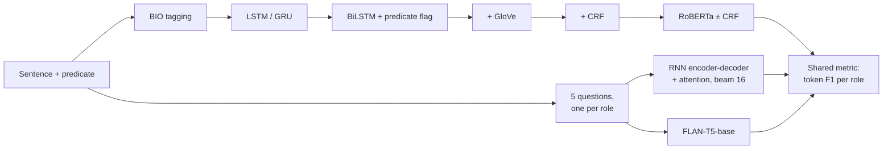
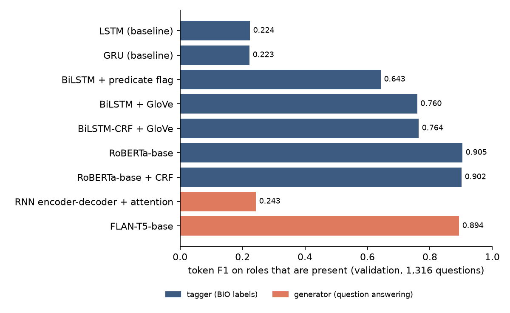

<div align="center">


</div>

# Semantic Role Labeling: Sequence Tagging vs. Question-Answering Generation

Semantic role labeling (SRL) answers *who did what to whom, when and where* for a predicate in a sentence:

```
[He]ARG0 would n't [accept]V [anything of value]ARG1 .
```

This project solves the same SRL task in two ways and scores both with one shared metric:
- **Tagging:** label every word with a BIO tag. The models range from a one-layer LSTM to RoBERTa with a CRF.
- **Generation:** ask one question per role and generate the answer. The models are an RNN encoder-decoder and FLAN-T5.

<div align="left">

[](https://www.python.org/downloads/)
[](https://pytorch.org)
[](https://github.com/huggingface/transformers)
[](#results-at-a-glance)
[](https://nlp.stanford.edu/projects/glove/)
[](LICENSE)

</div>

## Abstract

SRL is usually treated as sequence tagging, but it can also be posed as question answering: *"what is the ARG0 of* accept*?"* This project builds both kinds of system and evaluates them with one shared metric, token F1 on the roles that are present.

**Taggers.** Each ingredient is added one at a time:
- bidirectional reading and a predicate marker roughly triple span F1 (0.17 → 0.53);
- GloVe vectors and a larger network add 15 points;
- a BIO-constrained CRF adds 5 points by repairing span boundaries;
- fine-tuned RoBERTa reaches **0.880 span F1**.

**Generators.** An RNN encoder-decoder trained with no pre-training barely beats answering "nothing": 37% of the words it generates are not even in the sentence. Fine-tuned FLAN-T5 almost matches the best tagger (token F1 0.894 vs 0.902), copying 99.3% of its answers from the sentence.

**Metrics.** The data also invites misleading numbers. Two-thirds of the questions have no answer, and counting padding pushes token accuracy to 0.92 while span F1 is 0.14.

The full methodology, every table and the analysis are in the **[detailed report](REPORT.md)**.

## Table of Contents

1. [Key Features](#key-features)
2. [Project Workflow](#project-workflow)
3. [Results at a Glance](#results-at-a-glance)
4. [Repository Structure](#repository-structure)
5. [Installation and Usage](#installation-and-usage)
6. [Dataset](#dataset)
7. [Key Concepts Demonstrated](#key-concepts-demonstrated)
8. [Limitations](#limitations)
9. [References](#references)
10. [License](#license)

## Key Features

- **Linear-chain CRF written in PyTorch.** It implements the forward algorithm, Viterbi decoding and BIO transition constraints, and is checked against brute-force enumeration.
- **Predicate-aware RNN taggers.** They support LSTM or GRU cells, one or two directions, and a predicate-indicator embedding. Each word state is concatenated with the predicate's state. GloVe initialisation and a softmax or CRF output layer are options.
- **RoBERTa tagger.** It adds a learned predicate embedding to the input, represents each word by its first sub-token, and uses a softmax or CRF head.
- **Question-answering generators:**
  - an RNN encoder-decoder with additive attention, packed sequences, attention masking and beam search (beam 16);
  - FLAN-T5-base, fine-tuned for text-to-text answers.
- **One shared evaluation for both kinds of system:**
  - span F1 (CoNLL style, via `seqeval`) for taggers;
  - role exact match and token F1 for every system;
  - an "always answer nothing" baseline;
  - diagnostics: ill-formed BIO spans, and generated words that are not in the sentence.
- **Reproducible.** One script trains each model and `compare.py` writes the comparison. 11 unit tests run in CI.

## Project Workflow



## Results at a Glance

Results are on the validation set: 800 sentences and 4,000 role questions, 1,316 of which have an answer. Hyperparameters were fixed in advance and every score is from the last epoch, so nothing was tuned on these sentences.

| system | span F1 | role exact match | token F1 (role present) |
|---|---|---|---|
| *always answer nothing* | — | 0.671 | 0.000 |
| LSTM (baseline) | 0.168 | 0.676 | 0.224 |
| BiLSTM + predicate flag | 0.529 | 0.785 | 0.643 |
| BiLSTM-CRF + GloVe | 0.738 | 0.872 | 0.764 |
| **RoBERTa-base + CRF** | **0.880** | **0.935** | 0.902 |
| RNN encoder-decoder + attention | — | 0.703 | 0.243 |
| FLAN-T5-base (question answering) | — | 0.926 | 0.894 |

<p align="center">
  
</p>

## Repository Structure

```text
srl-tagging-vs-generation/
│
├── srl/                          # the library
│   ├── data.py                   # tag set, vocabulary, padding/collate, QA pairs, GloVe loading
│   ├── models.py                 # RNN tagger; encoder-decoder with attention and beam search
│   ├── crf.py                    # linear-chain CRF with BIO constraints
│   └── metrics.py                # span F1 and role-answer metrics
│
├── scripts/
│   ├── train_tagger.py           # RNN taggers
│   ├── train_transformer_tagger.py  # RoBERTa tagger (softmax or CRF)
│   ├── train_seq2seq.py          # RNN encoder-decoder
│   ├── train_t5_qa.py            # FLAN-T5
│   ├── compare.py                # shared evaluation -> results/comparison.md
│   └── plot_comparison.py        # results/comparison.png
│
├── results/                      # metrics and curves per model, comparison tables
├── tests/                        # 11 unit tests
├── REPORT.md                     # detailed report
├── run_all.sh                    # trains every model, then compares
└── requirements.txt
```

## Installation and Usage

```bash
git clone https://github.com/faezehmzf/srl-tagging-vs-generation.git
cd srl-tagging-vs-generation
python -m venv .venv && source .venv/bin/activate
pip install -r requirements.txt
# put train.json / valid.json / test.json and glove/glove.6B.300d.txt in data/ (see data/README.md)
bash run_all.sh            # trains every model, then writes results/comparison.md
python -m pytest -q tests  # unit tests, no data needed
```

Every script uses CUDA if available, then Apple MPS, then CPU. On an Apple M5 laptop the training times were:
- the RNN taggers: a few minutes each;
- each RoBERTa run: about 18 minutes;
- FLAN-T5: about 1 h 40 min.

## Dataset

The data is English sentences annotated with PropBank-style roles (ARG0, ARG1, ARG2, ARGM-TMP, ARGM-LOC) for one predicate each:
- 13,310 training sentences;
- 800 validation sentences;
- 800 unlabelled test sentences.

The source and licence of the copy used are not documented, so it is **not included**. [`data/README.md`](data/README.md) gives the format and statistics. GloVe 6B 300-d vectors are also needed, and the pre-trained transformers download automatically.

## Key Concepts Demonstrated

- Sequence labeling with BIO tags, span-level evaluation, and why exact span boundaries matter.
- Conditional random fields: the forward algorithm, Viterbi decoding, and hard transition constraints.
- Injecting the predicate into the encoder, through an indicator embedding and concatenation with the predicate's state.
- Transfer learning from pre-trained word vectors and from a pre-trained transformer.
- Sequence-to-sequence generation with attention, teacher forcing and beam search; copying vs. hallucination.
- Text-to-text fine-tuning (FLAN-T5) and its tokenizer limits.
- Evaluation pitfalls: absent-role baselines, counting padding, and non-deterministic GPU runs.

## Limitations

- **One run per model** on one 800-sentence validation set. Small differences, such as RoBERTa with and without the CRF, may be within run-to-run noise.
- **Fixed hyperparameters.** They were chosen in advance and not tuned on a separate split.
- **Reduced role set.** There are 5 roles and one predicate per sentence, so the results are not comparable to published CoNLL-2005/2012 numbers.

See the [report](REPORT.md#5-limitations) for details.

## References

- He, Lee, Lewis & Zettlemoyer (2017). Deep Semantic Role Labeling: What Works and What's Next. *ACL*.
- He, Lewis & Zettlemoyer (2015). Question-Answer Driven Semantic Role Labeling. *EMNLP*.
- Lafferty, McCallum & Pereira (2001). Conditional Random Fields. *ICML*.
- Bahdanau, Cho & Bengio (2015). Neural Machine Translation by Jointly Learning to Align and Translate. *ICLR*.
- Liu et al. (2019). RoBERTa. arXiv:1907.11692. Chung et al. (2022). Scaling Instruction-Finetuned Language Models (FLAN-T5). arXiv:2210.11416.

## License

The code is released under the [MIT licence](LICENSE). The data is not included; GloVe and the pre-trained models keep their own licences.

<div align="center">

</div>
