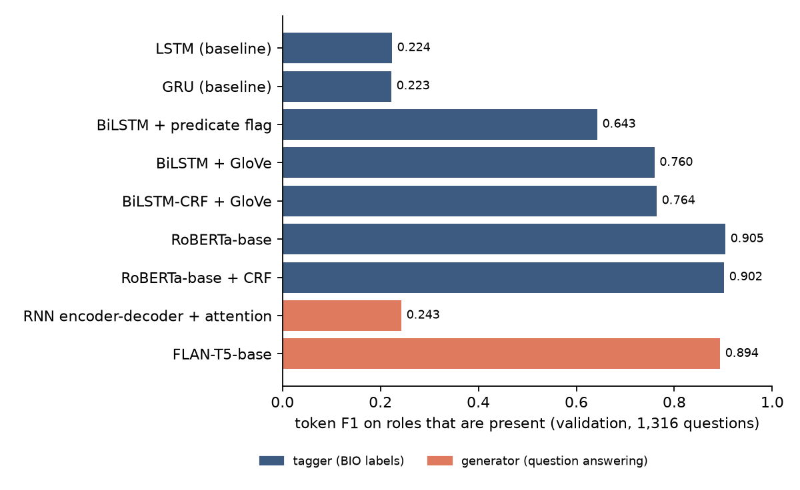

# Report: Semantic Role Labeling, Tagging vs. Generation

This report describes the task, the models, the experimental protocol and the results, and discusses what they show. Every number comes from [`results/comparison.md`](results/comparison.md) and the per-model `results/*/metrics.json` files, which are written by the scripts in [`scripts/`](scripts/).

## Contents

1. [Introduction](#1-introduction)
2. [Data](#2-data)
3. [Results](#3-results)
4. [Analysis](#4-analysis)
5. [Limitations](#5-limitations)
6. [Reproducibility](#6-reproducibility)
7. [References](#7-references)

---

## 1. Introduction

Semantic role labeling (SRL) answers *who did what to whom, when and where* for one predicate in a sentence:

```
[He]ARG0 would n't [accept]V [anything of value]ARG1 .
```

This project solves the same SRL task in two ways and measures both with one shared metric:

1. **Tagging.** Label every word with a BIO tag (`B-ARG0`, `I-ARG1`, `O`, ...). The models range from a one-layer LSTM to a fine-tuned RoBERTa with a CRF output layer.
2. **Generation as question answering.** Ask one question per role (*"what is the ARG0 of `accept`?"*) and generate the answer text. Two generators are used: an RNN encoder-decoder with attention trained with no pre-training, and a fine-tuned FLAN-T5.

It asks three questions:

- **What does each ingredient add to a tagger?** The ingredients tested are reading in both directions, a predicate marker, pre-trained word vectors, a CRF, and a pre-trained transformer.
- **Can a generator match a tagger?** This is tested both for a generator with no pre-training and for one that is pre-trained.
- **Which numbers mislead on this data?** The candidates are token accuracy, padding, and exact match on absent roles.

Everything is implemented in PyTorch. The CRF (forward algorithm and Viterbi decoding with BIO constraints), the taggers, the encoder-decoder and its beam search are all written here; Hugging Face `transformers` is used only to load the pre-trained RoBERTa and FLAN-T5 weights.

## 2. Data

The dataset is English sentences annotated with PropBank-style roles for one predicate each:

- Training set: 13,310 sentences.
- Validation set: 800 sentences.
- Test set: 800 unlabelled sentences, so all results are on validation.
- Roles: ARG0, ARG1, ARG2, ARGM-TMP and ARGM-LOC.

The source and licence of the copy used here are not documented, so it is **not included**. [`data/README.md`](data/README.md) gives the expected format and statistics, so any data in that format can be used.

The repository also needs GloVe 6B 300-d vectors (public domain); the pre-trained transformers download automatically.

## 3. Results

The validation set has 800 sentences, one predicate each, and 5 roles per predicate, which gives 4,000 (sentence, role) questions. Gold answers are present for 1,316 of them.

All models use fixed hyperparameters, and the reported numbers come from the last epoch, so nothing was tuned or selected on these 800 sentences. The full tables are in [`results/comparison.md`](results/comparison.md).

| system | span F1 | role exact match | token F1 (role present) | parameters | training time* |
|---|---|---|---|---|---|
| always answer nothing | — | 0.671 | 0.000 | — | — |
| LSTM (baseline) | 0.168 | 0.676 | 0.224 | 0.8M | 0.2 min |
| GRU (baseline) | 0.173 | 0.680 | 0.223 | 0.8M | 0.5 min |
| BiLSTM + predicate flag | 0.529 | 0.785 | 0.643 | 0.8M | 1.0 min |
| BiLSTM + GloVe | 0.684 | 0.853 | 0.760 | 4.4M | 2.9 min |
| BiLSTM-CRF + GloVe | 0.738 | 0.872 | 0.764 | 4.4M | 5.0 min |
| RoBERTa-base | 0.868 | 0.933 | 0.905 | 124.7M | 18.6 min |
| **RoBERTa-base + CRF** | **0.880** | **0.935** | 0.902 | 124.7M | 18.4 min |
| RNN encoder-decoder + attention (beam 16) | — | 0.703 | 0.243 | 6.3M | 24.0 min |
| FLAN-T5-base QA (beam 4) | — | 0.926 | 0.894 | 247.6M | 100.5 min |

\* Measured on one Apple M5 laptop GPU (MPS).

The columns are:

- **Span F1** is the standard SRL metric: an argument counts only if its label and both boundaries are exact (CoNLL style, computed with `seqeval`). Generators produce text rather than spans, so they have no span F1.
- **Role exact match** is the share of the 4,000 questions answered exactly. When the role is absent, the right answer is "nothing".
- **Token F1 (role present)** is SQuAD-style token overlap between the predicted and gold answers, averaged over the 1,316 questions whose role is present. This is the main metric shared by taggers and generators.

Token F1 per role (role present):

| system | ARG0 (n=357) | ARG1 (n=662) | ARG2 (n=219) | ARGM-TMP (n=68) | ARGM-LOC (n=10) |
|---|---|---|---|---|---|
| BiLSTM-CRF + GloVe | 0.736 | 0.808 | 0.692 | 0.765 | 0.500 |
| RoBERTa-base + CRF | 0.910 | 0.929 | 0.802 | 0.956 | 0.600 |
| RNN encoder-decoder + attention | 0.338 | 0.253 | 0.085 | 0.191 | 0.000 |
| FLAN-T5-base QA | 0.900 | 0.921 | 0.786 | 0.971 | 0.700 |



## 4. Analysis

### Tagging: each ingredient, in order

**A left-to-right LSTM barely works (span F1 0.17).** It labels each word before reading the rest of the sentence. Its token accuracy on real words is 0.824, lower than always predicting `O` (0.842), which shows why token accuracy is not reported here. Swapping the LSTM for a GRU changes nothing (0.173).

**Reading both ways and marking the predicate triples span F1 (0.168 → 0.529).** The model size stays the same (0.8M parameters). A BiLSTM sees the whole sentence before labelling a word, and a learned indicator embedding on the input tells it which verb the roles belong to.

**GloVe vectors and a bigger network add 15 points (0.529 → 0.684).** This step also adds a second layer, wider states, dropout and more epochs, so the gain is not from GloVe alone. The network then overfits: training token accuracy reaches 0.99 against 0.94 on validation, and validation loss is lowest at epoch 6 and rises after that. Span F1 still drifts up slowly.

**A CRF adds 5 points (0.684 → 0.738) by repairing span boundaries.** It does not find more of the right words: token F1 on present roles is nearly unchanged (0.760 → 0.764). The softmax tagger outputs 64 ill-formed `I-` tags (an `I-ARG1` with no `B-ARG1` before it) in 54 sentences, and span F1 counts every such fragment as an error. The CRF outputs none, because invalid transitions are blocked in its transition matrix and only valid label sequences are decoded.

**A pre-trained transformer adds another 14 points (0.738 → 0.880).** RoBERTa-base gets the predicate as a learned embedding added to its input. Each word is represented by its first sub-token and concatenated with the predicate's representation.

Over a strong encoder the CRF matters less (+1.2 points, 0.868 → 0.880), because RoBERTa alone produces only 24 ill-formed tags. ARG2 remains the hardest role (0.80). Its meaning depends on the verb (e.g., the recipient of *give*, the attribute of *be*), so it cannot be learned as one category the way ARG0 ≈ agent can.

### Generation: no pre-training vs. pre-trained

**The RNN encoder-decoder is barely above answering "nothing".** Its role exact match is 0.703 against 0.671 for the empty answer, and its token F1 on present roles is 0.243, close to the LSTM baseline tagger and far below the BiLSTM taggers.

The diagnostics show why: generating answer text is much harder than labelling words that are already in the sentence.

- 37% of the words it generates do not occur in the sentence at all. For example, it answers ARG2 of *"... it **is** a global brand"* with *"a recession"*.
- Only 48% of its non-empty answers are a contiguous piece of the sentence.
- Its output vocabulary is built from the training data, so 9% of the gold answer words in validation (281 of 3,129) cannot be produced at all.
- Beam search (size 16) barely helps over greedy decoding (token F1 0.243 vs 0.225). The model's errors are in what it learned, not in the search.

**A pre-trained generator almost matches the best tagger.** FLAN-T5-base, fine-tuned for 2 epochs on the same questions, reaches token F1 0.894 on present roles, against 0.902 for RoBERTa + CRF and 0.243 for the RNN encoder-decoder. Its role exact match is 0.926, against 0.935 for RoBERTa + CRF. This suggests the question-answering formulation was not the main problem for the RNN generator. That model had to learn language and copying from 13k sentences, while FLAN-T5 starts from pre-training.

FLAN-T5 has learned to copy:

- 99.3% of its non-empty answers (1,349 of 1,358) are a contiguous piece of the sentence.
- Only 1 of its 3,293 generated words is not in the sentence. It wrote *possibilitiess* where the gold answer has the misspelt *possibilitys*.
- 8 of the 9 non-contiguous answers are the right answer with its backtick dropped (the data writes opening quotes as backticks). The backtick is not in T5's vocabulary: it becomes the unknown token, which is removed on decoding. 10 of the 1,316 gold answers contain one, so those can never be matched exactly.

It leans towards answering. It gives an answer for 117 roles that are absent and misses 75 that are present; RoBERTa + CRF does 96 of each. Its weakest role is ARG2 (0.786), as for the taggers.

It also costs more:

- Twice the parameters of RoBERTa (247.6M vs 124.7M) and 5.4× the training time (100.5 vs 18.4 minutes).
- Five generated answers per sentence, one per role, instead of one tagging pass. Generating the 4,000 validation answers took 5.7 minutes.
- Its output is text, not positions. When a word occurs twice in the sentence, the answer does not say which one is meant, so span F1 cannot be computed for it.

### Pitfalls this data invites

- **About two-thirds of the questions have no answer.** On those, "always answer nothing" already scores 0.671 exact match. Any role-level score that includes absent roles needs that baseline beside it, which is why the main shared metric is restricted to present roles.
- **Counting padding inflates accuracy.** The baseline LSTM was rerun with padding scored as `O` and the two hidden states summed instead of concatenated (`results/pitfall_padding`). Its token accuracy is 0.917 with padding counted, 0.844 on real words (no better than always `O` at 0.842), and its span F1 is 0.136.

## 5. Limitations

- **One run per model and one validation set of 800 sentences.** Small differences, such as RoBERTa with and without the CRF (1.2 points), may be within run-to-run noise; runs on the Apple GPU are not bit-for-bit reproducible.
- **Hyperparameters were fixed in advance, not tuned.** Every model, especially the RNN encoder-decoder, could probably do better with tuning on a separate split.
- **ARGM-LOC has only 10 validation examples,** so its per-role scores are very noisy.
- **One predicate per sentence and a reduced role set (5 roles).** Results are not comparable to published CoNLL-2005/2012 numbers.

## 6. Reproducibility

```bash
python -m venv .venv && source .venv/bin/activate
pip install -r requirements.txt
# put train.json / valid.json / test.json and glove/glove.6B.300d.txt in data/ (see data/README.md)
bash run_all.sh           # trains every model, then writes results/comparison.md
python -m pytest -q tests # unit tests, no data needed
```

Individual runs:

```bash
python scripts/train_tagger.py --bidirectional --verb-flag-dim 16 --glove data/glove/glove.6B.300d.txt \
    --hidden-dim 128 --num-layers 2 --dropout 0.3 --epochs 15 --crf --out results/bilstm_glove_crf
python scripts/train_transformer_tagger.py --crf --out results/roberta_base_crf
python scripts/train_seq2seq.py --glove data/glove/glove.6B.300d.txt --out results/rnn_seq2seq
python scripts/train_t5_qa.py --out results/flan_t5_base_qa
python scripts/compare.py
```

Every script picks CUDA, then Apple MPS, then CPU. On an Apple M5 the RNN taggers take minutes, each RoBERTa run about 18 minutes, the RNN encoder-decoder about 24 minutes, and FLAN-T5 about 1 h 40 min plus 6 minutes of generation. The FLAN-T5 script uses batches of 8 with 4-step gradient accumulation to fit in 16 GB of memory.

**Tests.** The 11 unit tests run in CI. They check:
- the CRF's partition function and Viterbi path against brute force;
- that BIO constraints forbid ill-formed spans;
- that padding does not change tagger outputs;
- that beam search with beam 1 equals greedy decoding;
- that the transformer tagger maps words to their first sub-token.

## 7. References

- Palmer, Gildea & Kingsbury (2005). The Proposition Bank: An Annotated Corpus of Semantic Roles. *Computational Linguistics*.
- He, Lee, Lewis & Zettlemoyer (2017). Deep Semantic Role Labeling: What Works and What's Next. *ACL*.
- Lafferty, McCallum & Pereira (2001). Conditional Random Fields. *ICML*.
- Bahdanau, Cho & Bengio (2015). Neural Machine Translation by Jointly Learning to Align and Translate. *ICLR*.
- He, Lewis & Zettlemoyer (2015). Question-Answer Driven Semantic Role Labeling (QA-SRL). *EMNLP*.
- Pennington, Socher & Manning (2014). GloVe: Global Vectors for Word Representation. *EMNLP*.
- Liu et al. (2019). RoBERTa: A Robustly Optimized BERT Pretraining Approach. arXiv:1907.11692.
- Chung et al. (2022). Scaling Instruction-Finetuned Language Models (FLAN-T5). arXiv:2210.11416.
